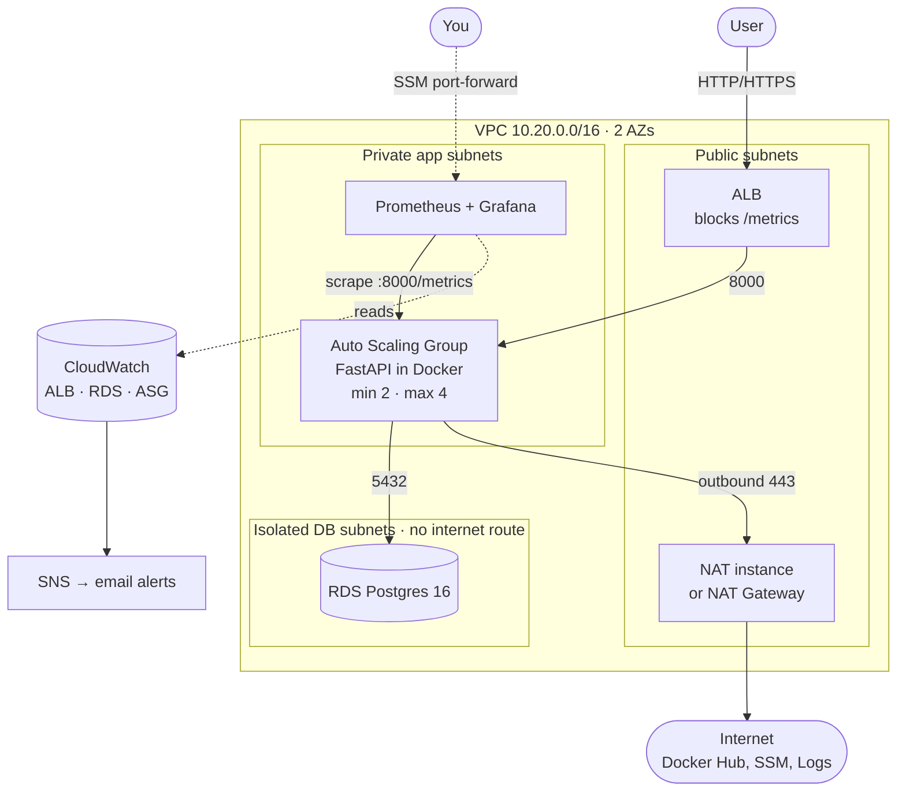

# TriTier ChatOps

A 3-tier DevOps chatbot on AWS, built entirely with Terraform: a load balancer in public subnets, an auto-scaling app tier in private subnets, and Postgres in isolated subnets with no internet route. Monitoring combines Prometheus (app metrics) and CloudWatch (AWS metrics) in Grafana.



**Security group chain:** internet → ALB SG (80/443) → app SG (8000) → DB SG (5432). Each rule references the previous tier's security group, not an IP range. Nothing has SSH open; shell access is through SSM Session Manager.

## Stack

| Layer | Tool |
|---|---|
| IaC | Terraform ≥ 1.10, S3 remote state with native locking |
| Network | VPC, 3 subnet tiers × 2 AZs, NAT instance (default) or NAT Gateway, free S3 gateway endpoint |
| Presentation | ALB (HTTP, optional HTTPS via ACM) + static chat UI |
| App | FastAPI + SQLAlchemy in Docker on an EC2 Auto Scaling Group (AL2023, IMDSv2) |
| Data | RDS Postgres 16, db.t4g.micro, encrypted, private |
| Secrets | SSM Parameter Store (SecureString) |
| Access | SSM Session Manager (no SSH, no bastion) |
| CI/CD | GitHub Actions with OIDC: plan on PR, apply on merge, rolling deploy via instance refresh |
| Registry | Docker Hub |
| Metrics | Prometheus with EC2 service discovery · CloudWatch |
| Dashboards | Grafana (2 provisioned dashboards) |
| Alerts | CloudWatch alarms → SNS → email |
| Logs | Docker `awslogs` driver → CloudWatch Logs |

## Repo layout

```
app/                    FastAPI app, chat UI, tests, Dockerfile
monitoring/             Prometheus + Grafana config (used locally and on AWS)
terraform/bootstrap/    one-time: state bucket + GitHub OIDC roles (local state)
terraform/modules/      network · security · data · app · monitoring
terraform/envs/dev/     wires the modules together
.github/workflows/      app.yml · terraform.yml · destroy.yml
docs/DESIGN.md          why each decision was made, cost notes, interview questions
```

## Run it

### 0. Cost guardrail (do this first)
In the AWS console, create a budget under **Billing → Budgets** with email alerts at a low amount. ALB, RDS and the NAT bill **hourly whether or not anyone uses the app**.

### 1. Locally (no AWS, no cost)
```bash
make test        # unit tests
cd terraform/envs/dev && terraform init -backend=false && terraform test   # offline infra plan test
make up          # app :8000, Prometheus :9090, Grafana :3000 (admin/admin)
```
Send a few chat messages, restart with `docker compose restart app`, and check the history survives. That proves the data tier is separate from the app.

### 2. Bootstrap (once)
```bash
cd terraform/bootstrap
terraform init && terraform apply     # set github_owner / github_repo if they differ
terraform output                      # note the bucket name and the three role ARNs
```

### 3. Push the first image
```bash
docker build -t adisru/tritier-chatops:latest app
docker push adisru/tritier-chatops:latest
```

### 4. Deploy the infrastructure
```bash
cd terraform/envs/dev
cp terraform.tfvars.example terraform.tfvars    # set alert_email
terraform init -backend-config="bucket=<state_bucket from step 2>"
terraform plan
terraform apply
terraform output app_url                        # wait ~4 minutes for instances to boot
```
Confirm the SNS subscription email AWS sends you, or you won't get alerts.

### 5. Open Grafana
```bash
eval "$(terraform output -raw grafana_password_command)"   # copy the password
eval "$(terraform output -raw grafana_tunnel_command)"     # keep this running
# open http://localhost:3000 → user admin
```
This needs the [Session Manager plugin](https://docs.aws.amazon.com/systems-manager/latest/userguide/session-manager-working-with-install-plugin.html) for the AWS CLI.

### 6. Wire up CI/CD
In GitHub repo **Settings → Secrets and variables → Actions**:

| Type | Name | Value |
|---|---|---|
| Variable | `DOCKERHUB_USERNAME` | `adisru` |
| Secret | `DOCKERHUB_TOKEN` | Docker Hub access token |
| Variable | `TF_STATE_BUCKET` | bucket from step 2 |
| Variable | `AWS_PLAN_ROLE_ARN` | from step 2 |
| Variable | `AWS_APPLY_ROLE_ARN` | from step 2 |
| Variable | `AWS_DEPLOY_ROLE_ARN` | from step 2 |
| Variable | `ALERT_EMAIL` | your email |

Then create an environment called **`production`** under **Settings → Environments** and add yourself as a required reviewer. The apply and deploy roles trust only that environment, so nothing changes AWS without your approval.

### 7. Tear down
```bash
terraform destroy          # or run the "destroy" workflow from the Actions tab
```
The bootstrap bucket stays (it has `prevent_destroy`). It costs almost nothing.

## Prove it works

These checks are the evidence for your write-up. Screenshot each one.

| Claim | How to prove it |
|---|---|
| DB is unreachable from the internet | RDS console shows *Publicly accessible: No*; DB route table has only the `local` route |
| Only the app can reach the DB | In an SSM shell, `timeout 3 bash -c '</dev/tcp/<rds-host>/5432' && echo open` prints `open` on an app instance and times out on the monitoring instance |
| `/metrics` isn't public | `curl http://<alb>/metrics` → 404 |
| Load balancing across AZs | Refresh the chat; the footer shows a different `served by` instance |
| Self-healing | Terminate one app instance; the ASG replaces it and the ALB never sends it traffic until it's healthy |
| Autoscaling | `hey -z 3m -c 50 http://<alb>/health`; watch the ASG grow in Grafana |
| Alerting | On one app instance run `sudo docker stop chatops` → unhealthy-hosts alarm email within ~3 minutes (or test just the email path with `aws cloudwatch set-alarm-state --alarm-name tritier-dev-target-5xx --state-value ALARM --state-reason test`) |
| Zero-downtime deploy | Run a load test while the deploy workflow does an instance refresh; no 5xx in Grafana |
